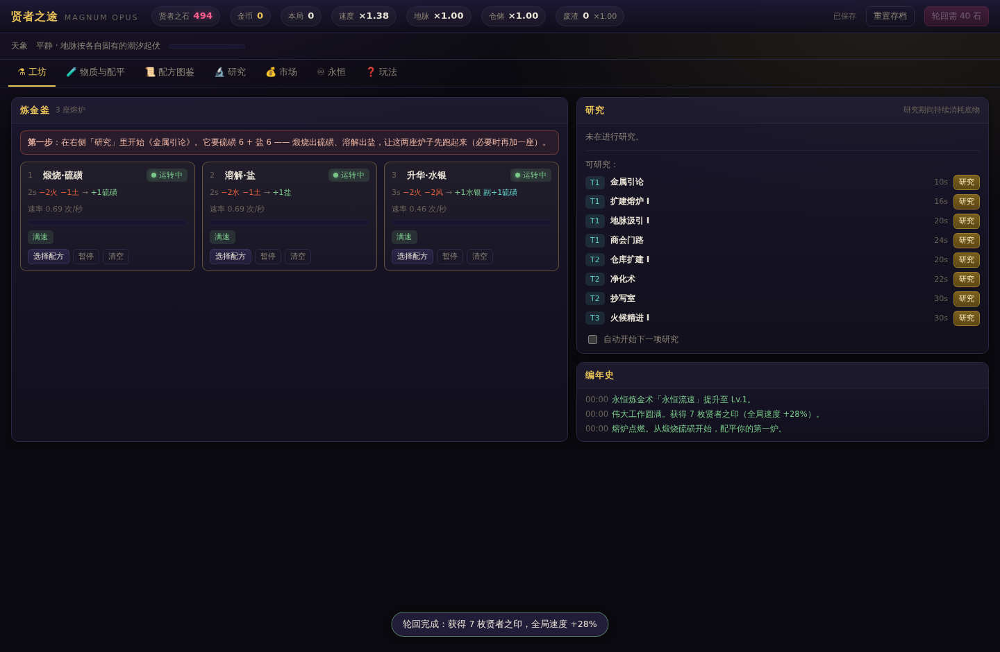
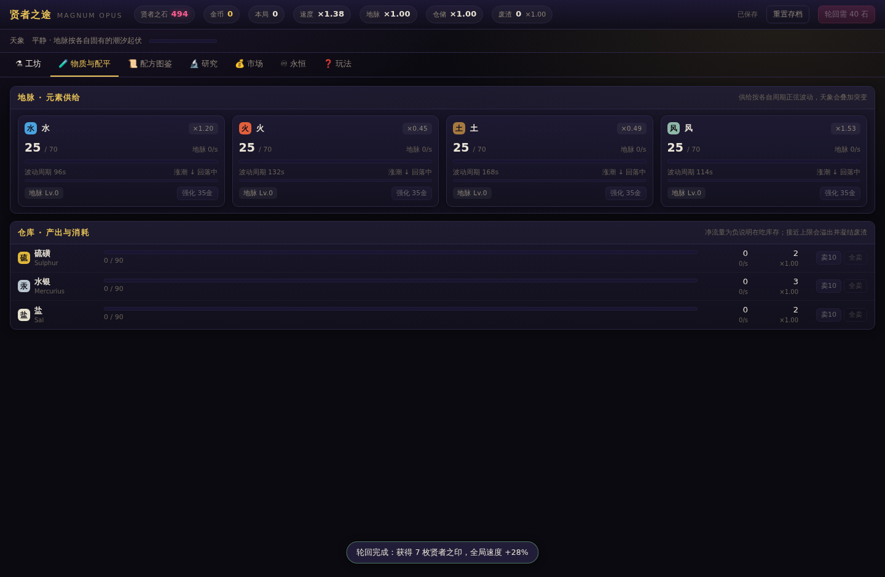
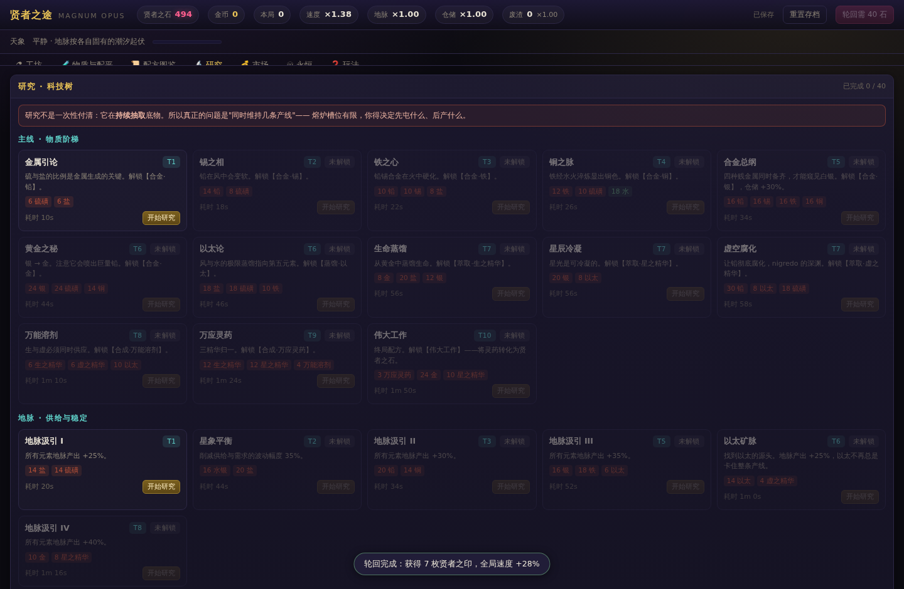

# 贤者之途 · Magnum Opus Idle

一个**纯前端**的炼金术士题材增量挂机游戏。用 [kiko](https://github.com/kiko-js/kiko)（基于 TC39 Signals 的细粒度响应式 DOM 库）构建，无虚拟 DOM、无框架运行时之外的依赖。

- 元素合成：4 大地脉元素 + 以太 → 三原质 → 七曜金属 → 三精华 → 万能溶剂 / 万应灵药 → **贤者之石**
- 配方有**副产物**：炼金会不管你愿不愿意喷出铅、铜、盐、硫，逼你把整条链配平
- **研究与产出需求随时间变化**：研究持续抽取底物，元素供给与商品需求各自按周期正弦波动，还叠加随机天象
- **产出必须被消耗**：科技研究、市场卖出、下游配方、轮回——仓库溢出会凝结废渣并拖慢全部地脉
- **局外成长**：贤者之石（伟业 + 伟大工作）→ 永恒炼金术；轮回 → 永久贤者之印

## 快速开始

```bash
bun install
bun run dev            # 开发服务器：Bun.serve + HMR，打开 http://localhost:4173/
bun run build          # 产出 dist/game.js
bun run serve          # 构建 + 起本地静态服务器
```

不想装依赖也行：仓库里已经有构建好的 `dist/game.js`，**直接双击 `index.html`** 即可离线游玩（纯前端，不需要服务器、不需要网络）。

| 命令 | 说明 |
|---|---|
| `bun run dev` | **开发服务器**：`Bun.serve` + kiko HMR，改 `src/` 即热替换（状态保留），默认 http://localhost:4173/；默认放行对外域名 `idle.10111234.xyz`（见下） |
| `bun run build` | 打包到 `dist/`（IIFE 单文件，可 file:// 直开） |
| `bun run build -- --min` | 压缩构建（不含 sourcemap） |
| `bun run serve` | 构建并起静态服务器 |
| `bun test` | 33 项测试：内核单元测试 29 项 + 平衡回归护栏 4 项 |
| `bun run verify` | 构建后用**真实无头 Chrome** 跑 85 项端到端验收（渲染 / 样式生效 / 交互 / 反应式更新 / **面板不重建（防闪烁）** / **编年史增量插入与滚动锚定** / 存档 / 离线结算 / 轮回 / 5 种屏幕宽度的响应式布局 / `file://` 直开） |
| `bun run dev:check` | HMR + Host 验收：真的起 dev server，在浏览器里分别经**回环**与**允许域名**改一行源码，验证热替换且**不整页刷新、状态不丢**，并验证未放行的 Host 会被 403 |
| `bun run typecheck` | `tsc --noEmit` |
| `bun run tools/playtest.ts 90` | 自适应机器人试玩 90 分钟，打印推进曲线（1 秒跑完） |
| `bun run tools/audit-flicker.ts` | 闪烁审计：逐页签检查有没有 DOM 元素被重建 |
| `bun run tools/gen-doc-tables.ts` | 从内容表重新生成 `docs/tables.generated.md` |

> 在 URL 后加 `?nosave=1` 可以完整试玩但**不写 localStorage**——录屏、调试，或想开一局不碰自己存档时很有用。

## 开发时的热替换（HMR）

`bun run dev` 用 Bun 的全栈 dev server 即时打包 `src/main.tsx`（`dev.html` 是开发外壳，
生产外壳仍是根目录的 `index.html`），`bunfig.toml` 里的 `[serve.static] plugins`
把 `src/` 下的模块改写成"HMR 注册表包装 + 端点胶水"：

- **改 `src/ui/*.tsx` 里的组件**：原位热替换，组件内部信号按创建序恢复（输入框、展开状态、
  游戏进度都不丢），不刷新页面；
- **独立端点 `/hmr`**：`GET` 走 SSE，带 `Upgrade: websocket` 走 WebSocket；`dev.html` 里
  用 `globalThis.__KIKO_HMR__ = { transport: "ws" }` 指定传输方式；
- **纯逻辑模块**（`src/sim/*.ts`）改动会退回整页刷新——内核状态在 `main.tsx` 的模块作用域里，
  没有可以复用的组件实例，这是预期行为。

> **一个必须遵守的约定：组件只能收一个 props 对象。**
> kiko 的 HMR 重挂载实例时用 `impl(inst.props)` 重放，位置参数只保得住第一个。
> 所以 `SlotCard(v, a, i)` 这种写法在开发时会被重放成 `SlotCard(v)`，`a`/`i` 变
> `undefined`，渲染抛错并退化成整页刷新。项目里所有组件都收 `{ v, a, id }` 这样的对象
> （见 `src/ui/panels.tsx` 的 `Ctx`），调用处一律写成 JSX（`<SlotCard v={v} a={a} i={i} />`）。

### 经域名访问：Host 允许名单 + 反向代理

Bun 的 dev server 有 **DNS-rebinding 防护**：Host 头不是本机地址时一律 403
`Blocked: Host header does not match the dev server`。而隧道 / 反向代理转发过来的 Host
正是公网域名，所以直接暴露会全部 403；Bun 1.4.x 还没有开放这个允许名单
（`development.allowedHosts` 尚未发布，详见 [oven-sh/bun#40733](https://github.com/oven-sh/bun/pull/40733)）。

`dev.ts` 因此自己做了这一层，默认放行 **`idle.10111234.xyz`**：

```
公网 / 隧道 ──▶ 外层监听器（0.0.0.0:PORT，Host 允许名单 + 反向代理）
                   │  转发时把 Host / Origin 改写成环回地址
                   ▼
             内层 dev server（127.0.0.1:随机端口，HTML 路由 + HMR + /hmr）
```

- 允许名单 = 本机回环（`localhost` / `127.0.0.1` / `::1`）+ `DEFAULT_PUBLIC_HOSTS`
  （`dev.ts`，当前是 `idle.10111234.xyz`）+ 环境变量 `DEV_ALLOWED_HOSTS`（逗号分隔）；
- 支持 `.example.com` 形式放行整个子域，`*` 表示不限制（**不安全**，仅本机临时用）；
- Host 只比主机名，**端口不敏感**（`idle.10111234.xyz:443` 也放行），因此 https 由上游
  代理终结、转发到本机 http 端口即可；
- WebSocket 由外层升级后桥接到内层，所以 Bun 自带的 HMR（`/_bun/hmr`）和 kiko 的
  `/hmr` 经域名访问都照常工作（`bun run dev:check` 会在真实域名下验证这一点）。

```bash
bun run dev                                          # 默认放行 idle.10111234.xyz
DEV_ALLOWED_HOSTS=my.example.com,.try.example.com bun run dev
```

> 上游反向代理/隧道需要把 **WebSocket 升级** 原样转发（否则热替换连接不上），
> 并保留原始 `Host` 头——Host 校验在 `dev.ts` 里做。


## 玩法速览

**三重张力**

1. **槽位有限**：开局 3 座熔炉，最多 8 座（元升级还能再加）。后期一条完整产链要十几个配方，你不可能同时全开，必须决定先屯什么、后炼什么。
2. **研究在持续抽血**：研究不是一次付清，而是研究期间每秒消耗那组底物。断了就慢下来（进度保留）。所谓"配平"就是让好几种中间产物同时供得上。
3. **副产物不由你决定**：仓库有上限，满了就溢出、凝结成废渣，废渣拖慢所有地脉。要么喂给下游配方，要么趁行情好卖掉。

**时间在变**

- 每条地脉按自己的周期正弦波动（水 96s / 风 114s / 火 132s / 土 168s / 以太 300s），幅度 ±55%
- 每 16~50 秒降临一次**天象**（12 种），同时改变供给与需求，并且**提前预告**
- 商品需求也按各自周期波动（0.4× ~ 1.6×），市场页有周期条可以预判

**局外成长**

- **贤者之石**来自「伟业」（17 项，每局重置，可反复拿）与终局配方「伟大工作」
- 石头买**永恒炼金术**（9 项元升级，永久保留）
- **轮回**把本局成绩换成**贤者之印**，每枚 +4% 全局速度

## 界面

| 工坊 | 物质与配平 | 研究 |
|---|---|---|
|  |  |  |

（截图由 `bun run verify.ts` 在无头 Chrome 中自动生成，始终反映当前构建。）

## 项目结构

```
index.html                静态外壳（生产入口，指向 dist/game.js，可 file:// 直开）
dev.html                  开发外壳（bun run dev 用，加载 src/main.tsx 源码模块）
bunfig.toml               [serve.static] 打包插件：注入 kiko HMR 胶水（只影响 dev server）
dev.ts                    开发服务器：Bun.serve + /hmr 端点 + 文件监听 + Host 允许名单 / 反向代理
build.ts                  Bun 打包脚本（IIFE 单文件 + 可选静态服务器）
verify.ts                 无头 Chrome 端到端验收（85 项）
src/
  main.tsx                装配：内核 + 视图 + 游戏循环 + 存档
  sim/                    纯逻辑内核，完全不依赖 DOM，可被 bun test 直接覆盖
    types.ts              物质 / 配方 / 科技 / 状态类型
    content.ts            全部游戏数据（物质、配方、科技树、天象、元升级、伟业、催化剂）
    engine.ts             模拟内核：地脉波动、供水式配平、研究、市场、废渣、伟业、轮回
    save.ts               存档序列化 / 反序列化 / 离线结算
    format.ts             数字与时间格式化
  ui/                     kiko 视图层
    view.ts               视图信号层（内核 → 信号，每 tick 同步一次）
    app.tsx               根组件：布局、页签、弹层
    panels.tsx            七个页签面板（含编年史的滚动锚定）
    components.tsx        共享小组件
    styles.ts             全局 CSS
test/
  engine.test.ts          内核单元测试（29 项）
  balance.test.ts         平衡回归护栏（4 项，机器人试玩）
tools/
  playtest.ts             自适应配平机器人（也作为平衡测试的驱动）
  audit-flicker.ts        闪烁审计：逐页签检查有没有元素被重建
  audit-hmr.ts            HMR 验收：改源码 → 热替换且不丢状态
  gen-doc-tables.ts       从内容表生成 markdown 表格
docs/
  DESIGN.md               完整设计文档（经济模型、公式、数值表、平衡实测）
  tables.generated.md     自动生成的数值表
```

## 为什么用 kiko

kiko 把 JSX 直接编译成真实 DOM 节点，组件函数只执行一次，信号变化只更新**被读取到的那个节点**。对挂机游戏这种"数字每 100ms 变一次、但结构基本不变"的场景非常契合：

- **列表用静态结构 + 信号绑定**：18 种物质、12 个熔炉槽位、39 个科技节点的 DOM 只构建一次，之后只有文本/宽度节点更新。
- **动态列表用 keyed `For`**：编年史与"可研究"列表按 key 增量增删行，存活的行复用同一批 DOM 节点。
- **`Signal.State` 值不变就不通知**：没变化的数字不会触发任何 DOM 操作。
- **`computed` 负责格式化**：`fmt()` 只在依赖的数字变化时才重算。
- **`Show` / 控制流组件**：页签切换和槽位显隐不引入额外包裹元素。

游戏循环每 100ms 用固定步长（0.1s）推进一次内核，然后把状态推进信号（`sync()`）。UI 的点击操作直接改内核并立即同步。内核本身是普通可变对象——跑得快，也方便在 Node/Bun 里做无 DOM 的批量模拟（机器人试玩 90 分钟只需 1 秒）。

### 一个必须记住的 kiko 坑：不要把 DOM 构建放进 `computed`

kiko 在构建 DOM 时会对每个绑定**读一次**它的信号（用于渲染初始值）。如果这次构建是发生在某个
`computed` 内部，那么这些"读一次"就会**全部变成这个 computed 的依赖**：

```tsx
// ✗ 错误：面板里任何数字一变，整个面板 DOM 就会被拆掉重建
<main>{computed(() => panelFor(v.tab.get(), v, a))}</main>

// ✓ 正确：用 untrack 让计算只依赖 tab；面板内部的绑定仍由 kiko 自己的 watcher 驱动
<main>{computed(() => { const tab = v.tab.get(); return untrack(() => panelFor(tab, v, a)) })}</main>
```

**同一个坑还有"小一号"的版本**：不只是整块面板，任何"**在一个 `computed` 里构建 DOM，而这块 DOM 内部
还有别的信号绑定**"的写法都会中招 —— 内层绑定会变成外层 `computed` 的依赖，于是那棵子树每 tick 都被
拆掉重建。项目里最初就有好几处：

```tsx
// ✗ 这个 <div> 会被每 tick 重建（内层 computed 成了外层的依赖）
{computed(() => {
  const r = recipe.get()
  if (!r) return null
  return <div class="al-io"><span>{computed(() => `${sv.ratio.get()}`)}</span></div>
})}

// ✓ 分支条件照常 track，DOM 构建放进 untrack
{computed(() => {
  const r = recipe.get()
  if (!r) return null
  return untrack(() => <div class="al-io"><span>{computed(() => `${sv.ratio.get()}`)}</span></div>)
})}
```

还有一条相关规则：**分支条件要读"离散量"，不要读连续量**。如果 `computed` 里用
`tv.progress.get() > 0.001` 判断要不要渲染，那它照样每 tick 重跑；应该让 `sync()`
把 `progress > 0.001` 这种布尔量单独推进一个信号，`computed` 只依赖那个布尔量。

实测过的后果：修之前整块面板每秒被重建 10 次（按钮、下拉选择器、滚动条疯狂闪）；修完之后
**七个页签里没有任何一个元素会被重建**，剩下的只有"数字真的在变"这种必要更新，每 tick 约 4% 的主线程预算。

`bun run tools/audit-flicker.ts` 是专门的闪烁审计：在"研究进行中 + 日志已满 + 配方选择器展开"的
真实局面下逐个页签给**每个元素**打标记，只要有任何一个元素被换掉就报错。`bun run verify`
里也内置了同样的护栏（以及"编年史必须是增量插入"的检查）。

### 列表刷新时的行为：keyed `For` + 滚动锚定

列表每 tick 都在变数字是这类游戏的常态，风险不在"更新"，而在**更新方式**：一旦整块 DOM 被
重建，正在阅读/操作的读者就会丢焦点、丢 hover，滚动条还会被打回顶端。项目里两条规则：

1. **动态列表一律 keyed**：`<For each={...} getKey={...}>`。编年史用事件 id 做 key，
   "可研究"列表用科技 id 做 key —— 集合变化时只增删变动的行，其余行在存活期内保持同一批节点
   （`src/ui/view.ts` 里的 `researchSuggest` 只在集合真的变化时才推新数组，所以 refresh 不跟
   每 tick 的进度绑定）。
2. **滚动位置由自己接管**：`.al-log` 上加了 `overflow-anchor: none`，关掉浏览器自带的滚动锚定
   （`.al-log` 是 flex 容器，实测 Chrome 在这里并不锚定），改由 `ChronicleLog` 的 `ref`
   记录"视口顶部那一行"，在 `MutationObserver` 的微任务里（绘制之前）把它放回原位置：
   - 正在读历史 → 新事件从顶部插入也不会把你推走，更不会跳回顶端；
   - 本来就在顶端 → 不介入，继续跟随最新一条。

`bun run verify` 的 12.66/12.67 就是这两条的回归护栏：滚动后插入 5 条新事件，断言锚点行
相对视口漂移 ≤ 2px、`scrollTop` 未被清零；完成一项研究后，断言只有那一行被淘汰、其余行仍是
同一批节点。

## 数值与平衡

完整的经济模型、公式推导与数值表见 [docs/DESIGN.md](docs/DESIGN.md)。机器人试玩的实测曲线：

| 阶段 | 机器人（相当于熟练玩家）耗时 |
|---|---|
| 第一项研究完成 | ~30s |
| 第一颗贤者之石（首个伟业） | ~1m |
| 解锁【伟大工作】 | ~24m |
| 点满全部 40 项研究 | ~35m |
| 单局贤者之石产出（75 分钟） | ~290（≈ 6 枚贤者之印） |
| 第二局解锁【伟大工作】 | ~10m（+24% 速度，且已买过元升级） |

## 许可

MIT
